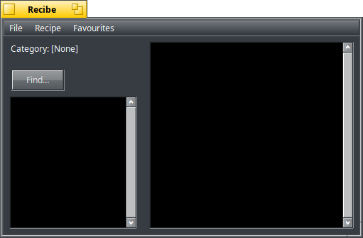

# Recibe    

 
a Recipe Manager for Haiku

---

This project was originally written by a talented coder who
laid a strong foundation. After the project lay dormant for quite a period
of time, I decided to dust it off and shine some light on it.

**The goal is to:** make it a full-featured Recipe app on Haiku.

Credit to the original author (DarkWyrm) whose work this builds directly upon.

> Sikosis · **Maintainer** · [GitHub](https://github.com/sikosis)

---

## About This Version

Since the original ca61659 codebase, we have made these updates:
- Replaced SQLite and CppSQLite3 with Haiku’s native filesystem and Storage Kit.
  - Recipes now live under ~/config/settings/Recibe/recipes.
  - Each category is a directory.
  - Each recipe is an individual flattened BMessage file.
  - Recipe files carry RECIBE:name, RECIBE:category, and RECIBE:number attributes.

- Reworked recipe operations for filesystem storage:
  - Add, edit, delete, search, print and display recipes.
  - Add, delete and rename/change categories.
  - Sort categories and recipes.
  - Handle recipe-number collisions when changing categories.
  - Added store locking for safer access.
  - Automatically create the default Misc category.
- Removed SQLite from the build:
  - Removed CppSQLite3.cpp, sqlite3.h, and libsqlite3 from project dependencies.
  - Added libstdc++ to resolve C++ runtime linker failures.
  - Updated the Pe project file and makefile dependencies.
- Improved recipe browsing:
  - Corrected page-count calculations.
  - Replaced SQL pagination with filesystem-backed recipe enumeration.
  - Retained browse and edit page sizes.
  - Limited search results to 200 recipes.
- Clarified saving versus exporting:
  - Recipes are saved immediately as individual files.
  - Renamed Save… to Export Recipe….
  - Export writes the selected recipe to a separate styled-text file.
  - The export panel now suggests the recipe name.
  - Export shortcut is Shift+Command/Alt+S.
- Added File → Quit with Command/Alt+Q.
- Added locale-aware spelling:
  - Australian and British settings show Favourites.
  - Menu commands become Add to Favourites and Remove from Favourites.
  - Other locales retain Favorites.
  - Detection now uses Haiku’s native preferred-language and formatting-region settings, with a POSIX fallback.
- Updated the About window:
  - Copyright now reads ©2007 DarkWyrm / ©2026 Sikosis.
  - Removed the old copyright text baked into the JPEG.
  - Removed the baked-in version text from the image.
  - Copyright and version are now drawn dynamically over the clean background.
  - The displayed version comes from the app_version resource.
- Updated application icon transparency:
  - Corrected transparency in both the 32×32 and 16×16 legacy icon resources.
- Repaired the rebuilt About JPEG resource:
  - Corrected malformed resource-definition quoting.
  - Verified the embedded JPEG payload and resource preprocessing.
- Added README documentation describing the native recipe storage format.

## Storage

> [!IMPORTANT]
    SQLite is not required.

- Recibe stores recipes using Haiku's native Storage Kit.
- Categories are folders under <strong>~/config/settings/Recibe/recipes</strong>
- Each recipe is a flattened BMessage file with:
  - RECIBE:name
  - RECIBE:category
  - RECIBE:number attributes

---

## TODO

> [!WARNING]
    Lots of features I'd like to add but baby steps ... take it one day at a time and we'll just keep chipping away at it until it's perfect.

The ordered implementation plan is maintained in [ROADMAP.md](ROADMAP.md).
To continue development, ask to start the next roadmap phase.

    So the not finished, short list is:
      - Pictures
      - Hyperlinks
      - Coloured Display Text
      - Cleaner UI
      - Light and Dark Themes
      - Kitchen Conversion Table
      - Print - Recipe / Shopping List / Just Instructions

---

## About The Original Version

This would be the first release and it is what beta software really should be: stable as far as I can tell in regular use, but it is still possible that there are bugs in there somewhere. 

This project wasn't even supposed to exist. Like Mr. Peeps! I just sort of fell into it, and, once again, I'm glad I did. Recibe started out as a way for me to use recipes I already have a license to under Windows with software that has more recipes than I could make in a lifetime, even if I made a new one literally each meal. The software's recipes were stored in some sort of proprietary database, but I wrote a program to automatically save each recipe to a text file. After getting tired of beating my CD-ROM drive to death by ripping a couple of hundred thousand recipes to disk, I went searching on the Internet and discovered more than a couple of recipes which are now distributed with Recibe.

The Recipes

The database as of this writing contains some 52,000 or so recipes. I do not claim authorship or ownership of any of them. Many are attributed to someone or another, but many more are not. If you are the author of one or more recipes and would like them to  be removed, please contact me and I will do so.

I hope you enjoy Recibe and happy cooking!

DarkWyrm
darkwyrm@earthlink.net

